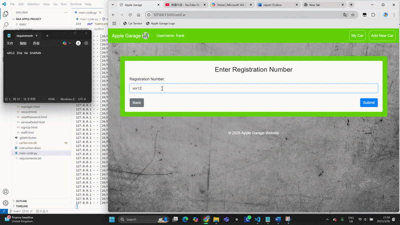

# 🚗 Apple Garage - Full-Stack Car Service & Garage Management System

[](https://www.python.org/)
[](https://flask.palletsprojects.com/)
[](https://www.sqlite.org/)
[](https://getbootstrap.com/)

A comprehensive, role-based full-stack web application designed to digitize and streamline car garage operations, appointment booking, and vehicle maintenance tracking. 

---

## 🌟 Features & Role-Based Access Control

The system supports three distinct user roles with tailored functionalities:

### 1. 👤 Customer Portal
* **Smart Vehicle Registration**: Automatically fetches vehicle specifications (MOT status, tax, make, engine capacity, etc.) via the **UK Government DVLA REST API** using just the registration number.
* **Online Booking**: Schedule maintenance services (MOT, Full Service, Oil Change, Brakes, etc.), choose dates, and attach custom notes.
* **Maintenance History**: Track past and upcoming services, check real-time repair statuses, and cancel scheduled bookings.

### 2. 🔧 Staff Portal
* **Automated Check-in**: Daily attendance tracking upon staff login.
* **Job Management**: View available jobs, pick tasks, assign collaborating mechanics, and update job statuses (*Working, Paused, Completed*).
* **Technical Assistance**: 
  * Look up car part product codes and reference history.
  * View historical problem logs for specific vehicle models to troubleshoot faster.

### 3. 📊 Manager Dashboard
* **Color-Coded Master Service Record**: Instantly track shop-wide job progress using dynamic status color-coding (Scheduled, Working, Paused, Done, Paid).
* **Financial Management**: Input total service charges to finalize and close out completed jobs.
* **Administrative Control**: Create new staff accounts and manage overall garage workflow.

---

## 🛠️ Tech Stack

* **Backend**: Python, Flask, SQLite, `sqlite3`, `bcrypt` (secure password hashing & salting), `requests` (API integration).
* **Frontend**: HTML5, CSS3, JavaScript (ES6+), Bootstrap 4.5, Jinja2 templating.
* **External API**: UK Government Vehicle Enquiry Service (VES) API.

---

## 📸 Demo



---

## 🧭 Instructions & Quick Start

### Pre-configured Test Accounts
You can log in with the following existing user accounts to test different roles:

| Role | Username | Password | Description / Capabilities |
| :--- | :--- | :--- | :--- |
| **Customer** | `jiegao` | `2006` | Test vehicle registration via DVLA API, booking services, and viewing maintenance records. |
| **Staff** | `j` | `123` | Test daily check-in, viewing available jobs, logging parts and problems, and managing job statuses. |
| **Manager** | `m` | `789` | Test the master service record table, color-coded tracking, pricing entries, and staff account creation. |

---

## 🗄️ Database Schema & Architecture

The application runs on a robust relational SQLite database (`carService.db`) consisting of 7 interlinked tables:
* **`tblUser`**: Manages credentials, roles (`customer`, `staff`, `manager`), and secure bcrypt password hashes.
* **`tblCar`**: Stores vehicle details, custom user-entered models, and links to owners via Foreign Keys.
* **`tblService`**: Tracks service bookings, dates, pricing, statuses, and custom client notes.
* **`tblParts`**: Records specific car parts and Euro Car Parts product codes used during maintenance.
* **`tblProblem`**: Logs mechanic-reported issues for cross-reference and predictive troubleshooting.
* **`tblCheckIn`**: Tracks staff daily attendance records.
* **`tblServiceStaff`**: Manages many-to-many relationships for collaborative mechanic teams on a single job.

---

## 🚀 Installation & Local Execution

### Prerequisites
Make sure you have Python installed along with pip.

### 1. Clone the Repository
```bash
git clone [https://github.com/jiegaoooooooooooo/car-service-project.git](https://github.com/jiegaoooooooooooo/car-service-project.git)
cd car-service-project
